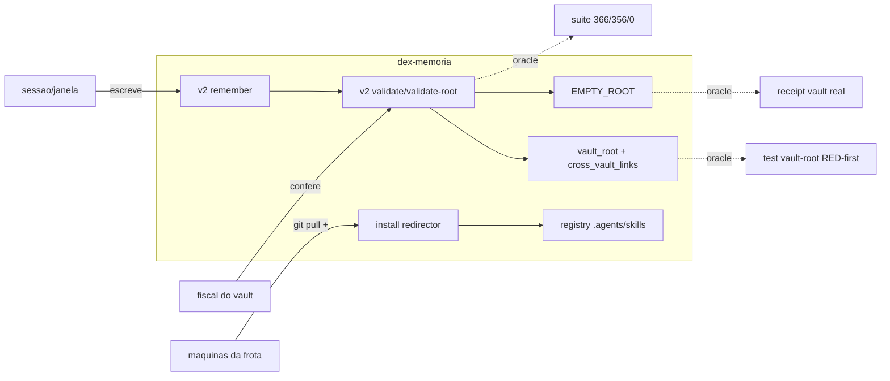

# CAPACITY.md — Fotografia de capacidades do dex-memoria

> Projeção derivada (não substitui SKILL/SPEC/fontes). Gerada pela skill
> `dex-mapa-capacidades`. Gatilho de staleness: `STALENESS-ARTEFATOS-DERIVADOS`
> em `.agents/GATILHOS-VIVOS.md` — fonte mudou condição de capacidade ⇒ regenere.

- **Objeto**: pacote `dex-memoria` (contrato documental + CLI de memória operacional Dex).
- **Fotografia**: `0.1.14` @ commit `corte 0.1.14 @ 18886ba` — 2026-11-07.
- **Ambiente observado**: Windows (win32 x64), Node 24 (contrato exige ≥18), Git Bash.
- **Fontes vivas**: `SKILL.md` (blob `ab86e8f7…`), `SPEC.md` (blob `73fd3939…`),
  `bin/dex-memoria.js` (blob `81f3c948…`), `bin/memory-v2-capabilities.js`
  (blob `4093c2f3…`), `docs/usage.md` (blob `129bf663…`) — git hash-object pos-edicao (issue #16).
- **Limites**: Linux/macOS e UI Obsidian não observados neste corte; capacidades
  do fluxo `create` são **fixture-only** por contrato (não gravam vault vivo).

## Matriz de capacidades observáveis

| Capacidade | Consumidor | Gatilho | Comportamento observável | Oracle independente | Evidência no corte |
| --- | --- | --- | --- | --- | --- |
| Diagnóstico de instalação (`doctor`) | dono/sessão | `dex-memoria doctor` | reporta memória home, skill canônica, versão | saída do comando + exit code | executado na esteira local (0 fail) |
| Instalação do redirector (`install`) | nova máquina/frota | `dex-memoria install` | atualiza SOMENTE o redirector global `.agents/skills/dex-memoria/SKILL.md`; rejeita `--target` | diff do redirector vs `registry/agents-skills` | contrato 0.1.7+; uso na frota |
| Escrita canônica (`v2 remember`) | sessão com achado memorável | payload fechado (scope/title/trigger/body/tags) | grava L1+L2/L3 com slug determinístico; receipt por rota; `FAILED` ecoa `failure.detail.validation_errors` | `v2 validate`/`validate-root` da unidade + `consciencia-memorias` | gravado 17× neste projeto (batch 16/16) |
| Transação V2 (`v2 plan\|apply\|resume\|recover`) | operador do vault | request JSON | journal + failpoints + recovery declarados | suíte de testes de transação | 366/356 pass (0 fail; 10 skipped) |
| Validação de unidade (`v2 validate`) | escritor (antes de fechar bloco) | `touched_paths` L1+destino | contrato de tags (aninhada, conjunto idêntico, corpo varrido) + backlinks | suíte `memory-v2-*` RED-first | issues #2/#3 (PR #4) |
| Validação de raiz (`v2 validate-root`) | fiscal de vault | request com `root` | ORPHAN_L1_LINE + contrato de tags no root inteiro | suíte + execução no vault real (378 arquivos) | medido 2026-11-07 |
| **Resolução cross-vault (`vault_root`)** — 0.1.8 | fiscal de vault composto | request com `vault_root` | link fora-da-raiz que resolve no vault vira `evidence.cross_vault_links` (auditável); morto continua `UNRESOLVED_*` | `test/memory-v2-vault-root.test.mjs` (4 cenários RED→GREEN) | issue #5 / PR #6 |
| **Anti verde-vazio (`EMPTY_ROOT`)** — 0.1.8 | fiscal | raiz com 0 arquivos lidos | `ok:false` + `EMPTY_ROOT` citando a raiz | teste `empty root` + execução real (`root=memories` → EMPTY_ROOT) | receipt `.agents/RECEIPTS/2026-11-07-issue5-real-vault-green.json` |
| **Cura classificada no receipt (`cure`/`UNCLASSIFIED`)** — 0.1.13; gate vacinado (bijecao precedencia + enum cure) e `contract_revision` no root — 0.1.14 | consumidor do receipt | action de recovery | toda action carrega `cure` da fonte única; código fora da tabela devolve `UNCLASSIFIED` (receipt denuncia a lacuna) | gate deriva MODOS de `MODE_BY_BUCKET` (nenhuma lista literal) | issue #14; testes RED→GREEN |
| Fixtures V0 (`create plan\|apply\|recover`) | mantenedor do contrato | CLI JSON fixture-only | bancadas descartáveis L1+L2 com schemas Draft 2020-12 | suíte `create-*` | fixture-only por SPEC |
| Gate de pacote (`npm run check` / `pack:check` / CI) | mantenedor/release | commit/PR | valida estrutura pública + 6 superfícies de versão alinhadas | GitHub Actions (PR #6: 2/2 SUCCESS) | validate-public sha vigente |
| Projeção externa (`PLAYBOOK.md`) | destinatário terceiro | `tools/playbook/generate-playbook.py` | projeção determinística + hook anti-drift | `--check` exit 0 | FRESCO (regen no commit de cada release) |

## Mermaid estático (capacidade → consumidor/oracle)

## Laudo

- **Confirmadas com oracle**: todas as 11 linhas da matriz (teste independente
  e/ou execução real com receipt neste corte).
- **Não comprovadas neste corte**: comportamento em Linux/macOS; paridade com
  UI Obsidian (o validador lê Markdown, não a UI); desempenho do coletor
  `vault_root` em vaults >> 10³ arquivos (custo proporcional, campo opcional).
- **Recibo machine-readable**: `dex.capacity.snapshot.v1` não emitido — nenhum
  consumer gate/CI o exige neste corte (declaração, não ausência de capacidade).

Owner da manutenção: sessão do repo (update ao tocar release/fontes vinculadas).
