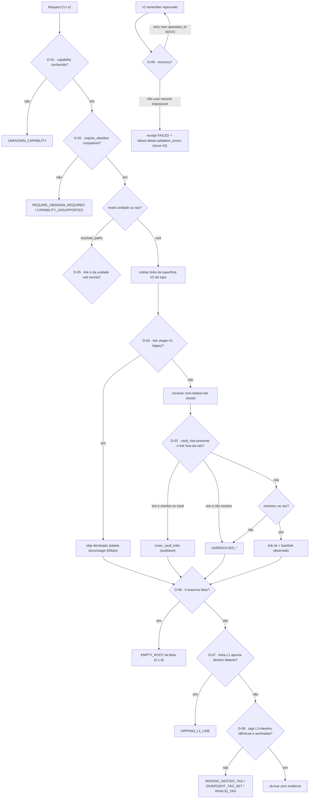

# DECISION-FLOW.md — Fluxo de decisões operacionais do dex-memoria

> Projeção consultiva derivada (skill `dex-mapa-das-decisoes`, modo
> **operacional**). O contrato canônico mora em `SKILL.md`/`SPEC.md`/`bin/`.
> Fonte mudou condição/ramo/owner ⇒ regenere (gatilho
> `STALENESS-ARTEFATOS-DERIVADOS`).

- **Corte**: `0.1.14` @ `corte 0.1.14 @ 18886ba` — 2026-11-07.
- **Cobertura**: prescrito (SKILL/SPEC/docs/usage) + **implementado**
  (`bin/dex-memoria.js` sha `1919c660…`, `bin/memory-v2-capabilities.js` sha
  `4956e454…` examinados) + **observado** (execuções com receipts nesta data).
- **Dependências externas**: Node ≥18; nenhum runtime/hooks automáticos.

## Tabela de decisões

| ID | Pergunta | Entrada/regra | Ramos e destinos | Owner | Fonte | Evidência/lacuna |
| --- | --- | --- | --- | --- | --- | --- |
| D-01 | capability conhecida? | `CAPABILITIES` map (3 chaves) | desconhecida → `UNKNOWN_CAPABILITY` | mantenedor | `bin/memory-v2-capabilities.js` | implementado+testado |
| D-02 | `require_obsidian` compatível? | legacy exige true; v2-markdown proíbe true; v2-obsidian exige true | incompatível → erro estável | mantenedor | idem | implementado+testado |
| D-03 | `vault_root` presente e link fora-da-raiz? | **0.1.8**: retry contra índice recursivo do vault | resolve → `cross_vault_links`; não resolve → `UNRESOLVED_*`; sem campo → fail-closed preservado | mantenedor | `docs/usage.md` §Semântica de Root + código | RED→GREEN 4 cenários + vault real (receipt) |
| D-04 | link shape-V1 legacy? | `isLegacyV1LinkTarget` (último segmento `memoria`/`lembranca` com caminho; `conhecimento/<slug>`) | sim → skip declarado (invisível ao validador, vivo no Obsidian) | mantenedor | docs §Skips (auditoria 14/14) | medido ao vivo (issue #5) |
| D-05 | modo unidade? | `isUnitRelation` com `touched_paths` | só links da unidade sob escrita são avaliados | mantenedor | código + SPEC | implementado+testado |
| D-06 | raiz leu 0 arquivos? | **0.1.8**: `files.length === 0` | `EMPTY_ROOT` ok:false citando a raiz (anti verde-vazio) | mantenedor | CHANGELOG 0.1.8 | teste + vault real (`root=memories`) |
| D-07 | linha L1 órfã? | labels unresolved saindo de `lembranca.md` | `ORPHAN_L1_LINE` citando destino | mantenedor | issue #2 / PR #4 | teste dedicado |
| D-08 | contrato de tags ok? | aninhada + conjunto idêntico + corpo varrido | `MISSING_NESTED_TAG`/`DIVERGENT_TAG_SET`/`INVALID_TAG` | mantenedor | docs §Contrato De Tags | testes + 4 repros reais |
| D-09 | remember reprovado, como recuperar? | transação rola back; recovery por novo `operation_id` | NUNCA `resume` impossível; receipt ecoa `failure.detail.validation_errors` | mantenedor | issue #3 / PR #4 | teste RED-first |
| D-10 | install copia o quê? | desde 0.1.7: SOMENTE redirector global | cópia completa/local = não-fonte; `--target` rejeitado | mantenedor | SKILL + CHANGELOG 0.1.7 | usado na frota |
| D-11 | canal de distribuição? | decisão do dono 2026-11-06 | Git/GitHub; registro npm descontinuado (0.1.5 histórico) | dono | `DECISIONS.md` sha `fb06029f…` | lavrada e publicada |
| D-12 | como liberar versão? | 6 superfícies alinhadas + contrato `validate-public` (5 pontos) + 2 hardcodes de teste | check/test/CI verde ⇒ tag + gh release | mantenedor | `scripts/validate-public.js` | pago 2× (0.1.7 e 0.1.12); travado |

## Handoffs e lacunas

- **Handoff frota**: máquina nova consome `git pull` + `install` (redirector) —
  nunca `npm install dex-memoria` (D-11).
- **Lacuna declarada**: `vault_root` resolve somente contra Markdown do vault
  (sem index Obsidian/FTS); custo proporcional ao tamanho do vault (campo opcional).
- **Conflitos**: nenhum prescrito×implementado aberto neste corte (a divergência
  do issue #5 — semântica de root não declarada — foi fechada declarando-a).

Owner da manutenção: sessão do repo. Revisar quando SKILL/SPEC/bin mudarem
condição, ramo, saída ou owner (hash no topo).
